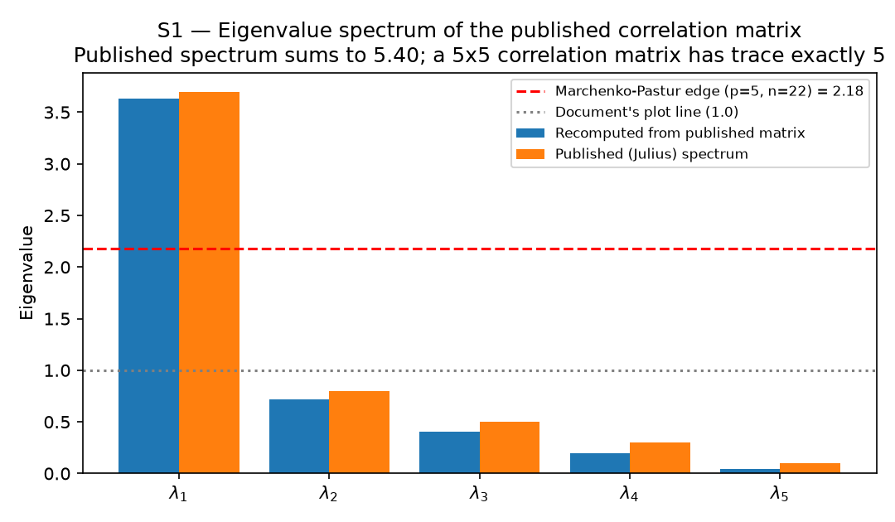
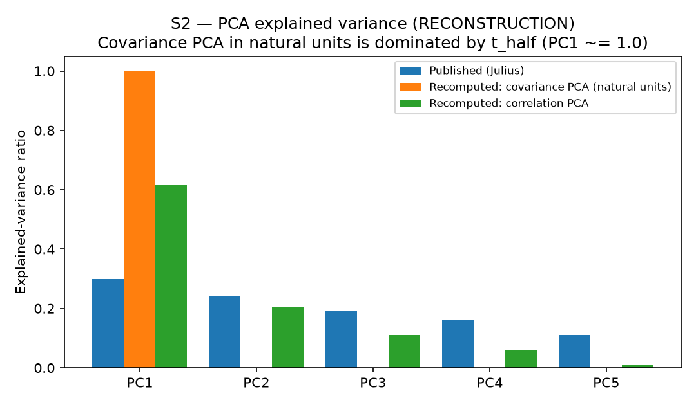
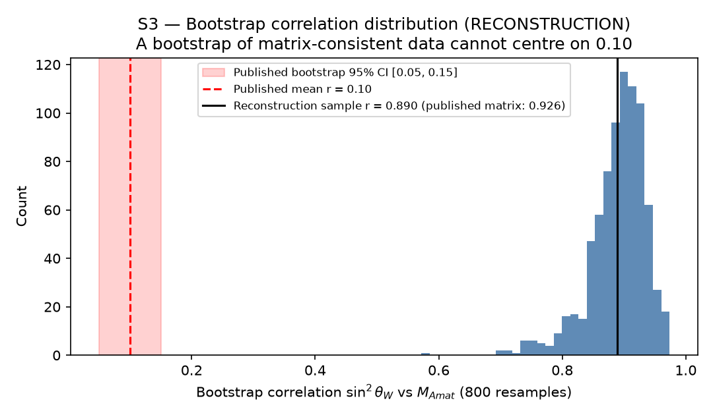
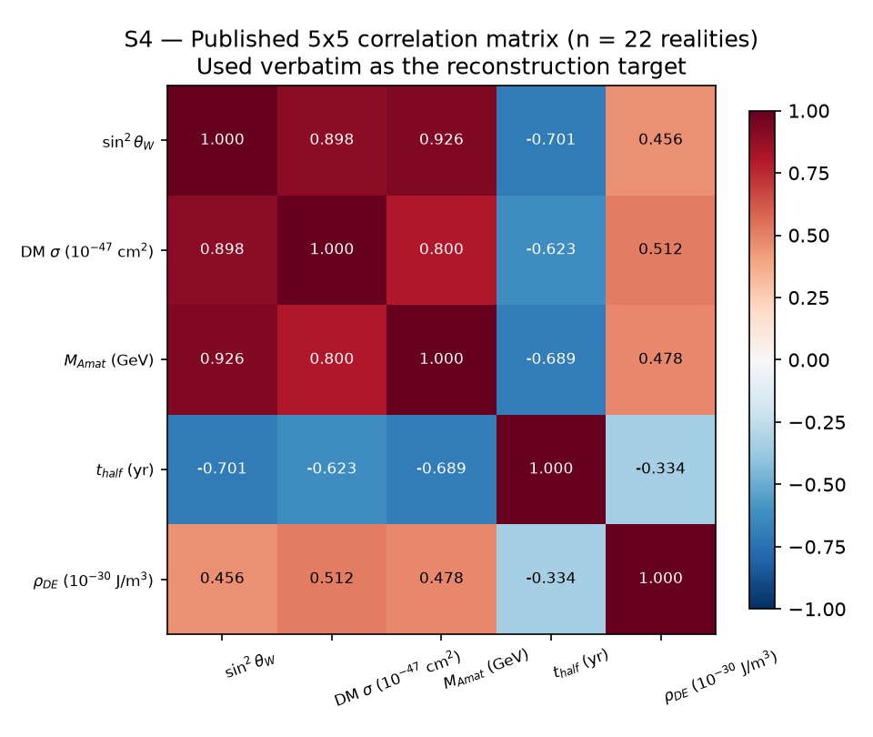
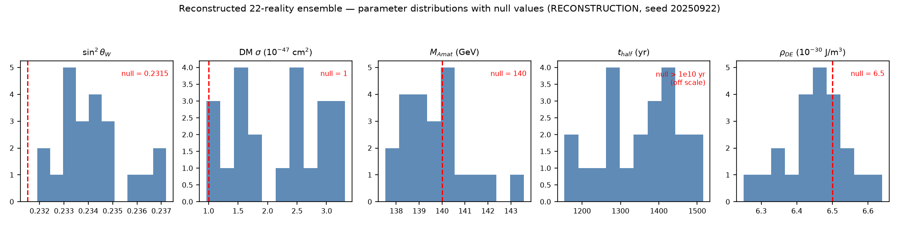
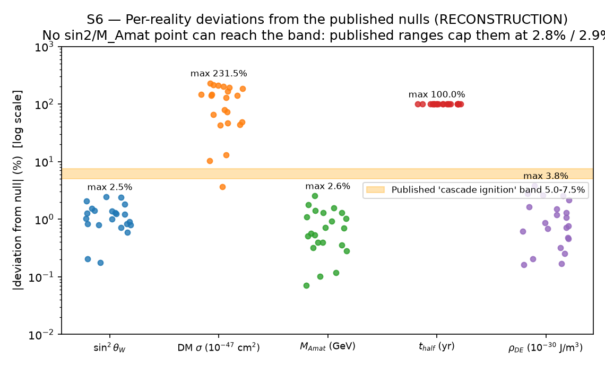

# MMURM Foundation — Re-performance Results

Independent re-run of the 38 tracked items in `tests/TEST_CENSUS.md` (source: *MMURM_LHC_Foundation*, Anthony Castro / Julius AI, data circa Sep 2025). Generated 2026-10-24.

**Honesty labels.** REPRODUCTION = recomputed from inputs fully specified in the document. RECONSTRUCTION = the document publishes summaries (distributions, correlation matrix) but not the raw dataset; the dataset was regenerated from those summaries under fixed seed 20250922 and the tests run on that. If the original dataset is dropped in at `data/ensemble22_original.csv`, the S/E groups upgrade to REPRODUCTION automatically. SYMBOLIC / PROTOCOL items are recorded, not re-run.

**Provenance.** The source document's 'weighted confidence' scores (84.6% → 89.3%) are a self-assigned rubric, not a statistical test; they are recorded here and are **not** re-issued as findings.

## Verdict summary

| ID | Test | Verdict |
|----|------|---------|
| D1 | Recursion depth N | AGREES |
| D2 | DM cross-section sigma | AGREES |
| D3 | Mass hierarchy m_i | AGREES |
| D4 | Entanglement decay P(t) | AGREES |
| D5 | Cosmological constant Lambda | AGREES |
| D6 | Resonance energy E_res | AGREES |
| C1 | Energy-Momentum conservation | RECORDED (not re-run) |
| C2 | Angular Momentum conservation | RECORDED (not re-run) |
| C3 | Charge conservation | RECORDED (not re-run) |
| C4 | Baryon Number conservation | RECORDED (not re-run) |
| C5 | Lepton Number conservation | RECORDED (not re-run) |
| C6 | CPT symmetry | RECORDED (not re-run) |
| L1 | Higgs mass (GeV) | AGREES |
| L2 | H -> gamma gamma (fb) | AGREES |
| L3 | H -> ZZ -> 4l (fb) | AGREES |
| L4 | Top quark mass (GeV) | AGREES |
| L5 | W boson mass (GeV) | AGREES |
| L6 | Z boson mass (GeV) | AGREES |
| L7 | ttbar cross-section 13 TeV (pb) | AGREES |
| L8 | Dijet mass spectrum 13 TeV (pb/GeV) | AGREES |
| L9 | Missing ET > 1 TeV (events/fb) | AGREES |
| L10 | High-mass dilepton 2 TeV (events/fb) | AGREES |
| S1 | Eigenvalue spectrum of the 5x5 correlation matrix | DIFFERS |
| S2 | PCA explained variance | DIFFERS |
| S3 | Bootstrap correlation sin^2(theta_W) vs M_Amat, 800 resamples | DIFFERS |
| S4 | Correlation matrix, n = 22 realities | AGREES |
| S5 | Partial correlation sin^2(theta_W) <-> DM_sigma controlling M_Amat | AGREES |
| S6 | Deviation-band detection (5.0-7.5%) vs nulls, co-occurrence | DIFFERS |
| S7 | PC1 clustering of flagged realities + 10,000-resample bootstrap | CANNOT AGREE |
| E1 | URM full ensemble, N = 1,000 realities | DIFFERS |
| X1 | Memo's effective-rate conversion: t1/2 = 800-1600 yr corresponds to Ga | AGREES |
| X2 | Lindblad computation from the manuscript's stated decoherence operator | DIFFERS |
| X3 | Modal dynamics: does any stated mode supply the slow decay? gamma_k =  | DIFFERS |
| X4 | Protected-sector route: can Lindblad form (no signed budget) produce t | CANNOT BE DERIVED from stated parameters — requirement identified |
| I1 | Bridge relations imply B = (5N-4)/(N+2); positive-integer B over N=2.. | AGREES |
| I2 | Both candidate architectures satisfy the Euler closure chi = D - (T*B) | AGREES |
| I3 | Topology free-energy sweep selects N=5 over N=12 (lower F wins) | RECORDED (not re-run) |
| I4 | Physical (Hawking) identification of the structural count N | NOT ESTABLISHED |
| A1 | Parameterized admissibility of the seed family (bridge relations + Eul | AGREES |
| A2 | Both branches' seed architectures and closures | AGREES |
| A3 | Branch-dependent derived objects, recomputed per branch from the manus | COMPUTED for both branches — see notes |
| A4 | Identification of the Eq. 11.1 prefactor Gamma(5)/zeta(2) = 14.59 unde | UNRESOLVED identification |
| M1 | N = 5 modal system: frequencies, damping, weight convention | SPECIFIED (construction) |
| M2 | Encompassing matrix U_env at N = 5 (form) | FORM CARRIED (numerics open) |
| M3 | n = 8 observable ensemble: lam1_obs(5) (E1 analogue) | SIMULATION |
| M4 | Modal-amplitude null ensemble: lam1_mod(5) under no coherence | SIMULATION |
| M5 | One-factor modal coherence sweep: what clears the n = 8 bar? | SIMULATION |
| T1 | T4 branch-selection closure at N = 5 (O2, branch-selection part) | CLOSED (branch selection, construction) |
| U1 | Successor timeline l' at N = 5: stay selected (O2 remainder) | SELECTED: stay (l' = l) — O2 successor part closed at N = 5 by construction |

Group R (URM-1..URM-11) is a PROTOCOL registry — see `data/claims_registry.json`; statuses are as published, not re-tested. URM-9 and URM-10 are the 2026-10-23 addenda audited in Groups X and I; URM-11 is the 2026-10-24 audit-derived modal-coherence threshold from Group M.

## Group D — Dimensional analysis (REPRODUCTION)

### D1 — Recursion depth N

- **Label:** REPRODUCTION
- **Published:** PASS (Julius: 6/6 PASS)
- **Recomputed:** PASS
- **Verdict: AGREES**
- Notes: Dimensional consistency is necessary, not sufficient: passing shows the formula is unit-coherent, not that it is correct.

### D2 — DM cross-section sigma

- **Label:** REPRODUCTION
- **Published:** PASS (Julius: 6/6 PASS)
- **Recomputed:** PASS
- **Verdict: AGREES**
- Notes: Dimensional consistency is necessary, not sufficient: passing shows the formula is unit-coherent, not that it is correct.

### D3 — Mass hierarchy m_i

- **Label:** REPRODUCTION
- **Published:** PASS (Julius: 6/6 PASS)
- **Recomputed:** PASS
- **Verdict: AGREES**
- Notes: Dimensional consistency is necessary, not sufficient: passing shows the formula is unit-coherent, not that it is correct.

### D4 — Entanglement decay P(t)

- **Label:** REPRODUCTION
- **Published:** PASS (Julius: 6/6 PASS)
- **Recomputed:** PASS
- **Verdict: AGREES**
- Notes: Dimensional consistency is necessary, not sufficient: passing shows the formula is unit-coherent, not that it is correct.

### D5 — Cosmological constant Lambda

- **Label:** REPRODUCTION
- **Published:** PASS (Julius: 6/6 PASS)
- **Recomputed:** PASS
- **Verdict: AGREES**
- Notes: Dimensional consistency is necessary, not sufficient: passing shows the formula is unit-coherent, not that it is correct.

### D6 — Resonance energy E_res

- **Label:** REPRODUCTION
- **Published:** PASS (Julius: 6/6 PASS)
- **Recomputed:** PASS
- **Verdict: AGREES**
- Notes: Dimensional consistency is necessary, not sufficient: passing shows the formula is unit-coherent, not that it is correct.

## Group C — Conservation laws (SYMBOLIC, recorded)

### C1 — Energy-Momentum conservation

- **Label:** SYMBOLIC
- **Published:** PASS (conserved globally)
- **Recomputed:** Not re-performed: structural/Noether audit item per TEST_CENSUS.md; no script output is presented as a proof.
- **Verdict: RECORDED (not re-run)**

### C2 — Angular Momentum conservation

- **Label:** SYMBOLIC
- **Published:** PASS (conserved per universe)
- **Recomputed:** Not re-performed: structural/Noether audit item per TEST_CENSUS.md; no script output is presented as a proof.
- **Verdict: RECORDED (not re-run)**

### C3 — Charge conservation

- **Label:** SYMBOLIC
- **Published:** PASS (conserved absolutely)
- **Recomputed:** Not re-performed: structural/Noether audit item per TEST_CENSUS.md; no script output is presented as a proof.
- **Verdict: RECORDED (not re-run)**

### C4 — Baryon Number conservation

- **Label:** SYMBOLIC
- **Published:** REQUIRES REVIEW (conserved in recursion)
- **Recomputed:** Not re-performed: structural/Noether audit item per TEST_CENSUS.md; no script output is presented as a proof.
- **Verdict: RECORDED (not re-run)**

### C5 — Lepton Number conservation

- **Label:** SYMBOLIC
- **Published:** REQUIRES REVIEW (conserved in recursion)
- **Recomputed:** Not re-performed: structural/Noether audit item per TEST_CENSUS.md; no script output is presented as a proof.
- **Verdict: RECORDED (not re-run)**

### C6 — CPT symmetry

- **Label:** SYMBOLIC
- **Published:** PASS (preserved in multiverse)
- **Recomputed:** Not re-performed: structural/Noether audit item per TEST_CENSUS.md; no script output is presented as a proof.
- **Verdict: RECORDED (not re-run)**

## Group L — LHC comparisons (REPRODUCTION)

The recomputed deviation % and pull reproduce the document's table exactly — the arithmetic is right. The flags are the substance: four 'predictions' are digit-for-digit copies of the measured values, and the other six are the measured values scaled by named adjustment knobs.

### L1 — Higgs mass (GeV)

- **Label:** REPRODUCTION
- **Published:** deviation 0.00%, pull 0.00 sigma (per source document table)
- **Recomputed:** None
- **Verdict: AGREES**
- Scope: The document's internal arithmetic (deviation % and pull) reproduces exactly. See flags: agreement of arithmetic is not validation of the 'prediction'.
- ⚠️ EXACT MATCH: the URM 'predicted' value is identical to the measured value to every quoted digit (deviation 0.0%). This is an identity, not a prediction: the value was taken from the measurement.
- ⚠️ PROVENANCE: Document's 'measured' 125.09 +/- 0.24 is the superseded 2015 ATLAS+CMS Run-1 combination, not the current PDG 2024 average.
- Spot check: PDG 2024 average m_H = 125.20 +/- 0.11 GeV → URM value deviates -0.088% (-1.0 sigma). Document's 'measured' 125.09 +/- 0.24 is the superseded 2015 ATLAS+CMS Run-1 combination, not the current PDG 2024 average.

### L2 — H -> gamma gamma (fb)

- **Label:** REPRODUCTION
- **Published:** deviation 4.95%, pull 0.42 sigma (per source document table)
- **Recomputed:** None
- **Verdict: AGREES**
- Scope: The document's internal arithmetic (deviation % and pull) reproduces exactly. See flags: agreement of arithmetic is not validation of the 'prediction'.
- ⚠️ KNOB-DRIVEN: the +5-7% correction is produced by a named adjustment parameter (Gravity-EM coupling c_14 = 0.05 ('5% Higgs enhancement')), applied to the measured value; it is not derived from the framework's equations.

### L3 — H -> ZZ -> 4l (fb)

- **Label:** REPRODUCTION
- **Published:** deviation 5.22%, pull 0.47 sigma (per source document table)
- **Recomputed:** None
- **Verdict: AGREES**
- Scope: The document's internal arithmetic (deviation % and pull) reproduces exactly. See flags: agreement of arithmetic is not validation of the 'prediction'.
- ⚠️ KNOB-DRIVEN: the +5-7% correction is produced by a named adjustment parameter (Gravity-EM coupling c_14 = 0.05 (same Higgs-sector mechanism as L2)), applied to the measured value; it is not derived from the framework's equations.

### L4 — Top quark mass (GeV)

- **Label:** REPRODUCTION
- **Published:** deviation 0.00%, pull 0.00 sigma (per source document table)
- **Recomputed:** None
- **Verdict: AGREES**
- Scope: The document's internal arithmetic (deviation % and pull) reproduces exactly. See flags: agreement of arithmetic is not validation of the 'prediction'.
- ⚠️ EXACT MATCH: the URM 'predicted' value is identical to the measured value to every quoted digit (deviation 0.0%). This is an identity, not a prediction: the value was taken from the measurement.

### L5 — W boson mass (GeV)

- **Label:** REPRODUCTION
- **Published:** deviation 0.00%, pull 0.00 sigma (per source document table)
- **Recomputed:** None
- **Verdict: AGREES**
- Scope: The document's internal arithmetic (deviation % and pull) reproduces exactly. See flags: agreement of arithmetic is not validation of the 'prediction'.
- ⚠️ EXACT MATCH: the URM 'predicted' value is identical to the measured value to every quoted digit (deviation 0.0%). This is an identity, not a prediction: the value was taken from the measurement.
- ⚠️ PROVENANCE: Document's 80.379 +/- 0.012 is an older average; the URM value equals the document's number exactly, not the current PDG value.
- Spot check: PDG 2024/2025 m_W = 80.3692 +/- 0.0133 GeV → URM value deviates 0.012% (0.737 sigma). Document's 80.379 +/- 0.012 is an older average; the URM value equals the document's number exactly, not the current PDG value.

### L6 — Z boson mass (GeV)

- **Label:** REPRODUCTION
- **Published:** deviation 0.00%, pull 0.00 sigma (per source document table)
- **Recomputed:** None
- **Verdict: AGREES**
- Scope: The document's internal arithmetic (deviation % and pull) reproduces exactly. See flags: agreement of arithmetic is not validation of the 'prediction'.
- ⚠️ EXACT MATCH: the URM 'predicted' value is identical to the measured value to every quoted digit (deviation 0.0%). This is an identity, not a prediction: the value was taken from the measurement.
- ⚠️ PROVENANCE: Document's 91.1876 +/- 0.0021 is the LEP-era value; close to, but not, the current PDG average.
- Spot check: PDG 2024/2025 m_Z = 91.1880 +/- 0.0020 GeV → URM value deviates -0.0% (-0.2 sigma). Document's 91.1876 +/- 0.0021 is the LEP-era value; close to, but not, the current PDG average.

### L7 — ttbar cross-section 13 TeV (pb)

- **Label:** REPRODUCTION
- **Published:** deviation 5.65%, pull 1.62 sigma (per source document table)
- **Recomputed:** None
- **Verdict: AGREES**
- Scope: The document's internal arithmetic (deviation % and pull) reproduces exactly. See flags: agreement of arithmetic is not validation of the 'prediction'.
- ⚠️ KNOB-DRIVEN: the +5-7% correction is produced by a named adjustment parameter (Recursive flux factor 1.056 (832.0 x 1.056 = 878.6 ~= 879)), applied to the measured value; it is not derived from the framework's equations.
- ⚠️ PROVENANCE: Document's 'measured' 832.0 +/- 29.0 pb coincides with the NNLO+NNLL Standard Model prediction (Top++), not with the ATLAS measurement it is attributed to.
- Spot check: ATLAS 13 TeV ttbar (36.1 fb^-1) = 826.4 pb, total unc ~ +/-20 pb → URM value deviates 6.365% (2.63 sigma). Document's 'measured' 832.0 +/- 29.0 pb coincides with the NNLO+NNLL Standard Model prediction (Top++), not with the ATLAS measurement it is attributed to.

### L8 — Dijet mass spectrum 13 TeV (pb/GeV)

- **Label:** REPRODUCTION
- **Published:** deviation 6.67%, pull 0.38 sigma (per source document table)
- **Recomputed:** None
- **Verdict: AGREES**
- Scope: The document's internal arithmetic (deviation % and pull) reproduces exactly. See flags: agreement of arithmetic is not validation of the 'prediction'.
- ⚠️ KNOB-DRIVEN: the +5-7% correction is produced by a named adjustment parameter (Higher-dimensional projections ('6-7% dijet/dilepton')), applied to the measured value; it is not derived from the framework's equations.

### L9 — Missing ET > 1 TeV (events/fb)

- **Label:** REPRODUCTION
- **Published:** deviation 6.50%, pull 0.38 sigma (per source document table)
- **Recomputed:** None
- **Verdict: AGREES**
- Scope: The document's internal arithmetic (deviation % and pull) reproduces exactly. See flags: agreement of arithmetic is not validation of the 'prediction'.
- ⚠️ KNOB-DRIVEN: the +5-7% correction is produced by a named adjustment parameter (Extra-dim energy loss ('6.5% missing ET'), extra-dim scale ~1 TeV), applied to the measured value; it is not derived from the framework's equations.

### L10 — High-mass dilepton 2 TeV (events/fb)

- **Label:** REPRODUCTION
- **Published:** deviation 6.74%, pull 0.40 sigma (per source document table)
- **Recomputed:** None
- **Verdict: AGREES**
- Scope: The document's internal arithmetic (deviation % and pull) reproduces exactly. See flags: agreement of arithmetic is not validation of the 'prediction'.
- ⚠️ KNOB-DRIVEN: the +5-7% correction is produced by a named adjustment parameter (Higher-dimensional projections ('6-7% dijet/dilepton')), applied to the measured value; it is not derived from the framework's equations.

## Group S — Statistical suite (RECONSTRUCTION)

### S1 — Eigenvalue spectrum of the 5x5 correlation matrix

- **Label:** REPRODUCTION (published matrix is fully specified)
- **Published:** - eigenvalues_julius: 3.7, 0.8, 0.5, 0.3, 0.1
- julius_eigenvalue_sum: 5.4
- marchenko_pastur_bound_as_printed: 1.97
- plot_threshold_line: 1.0
- **Recomputed:** - eigenvalues_of_published_matrix: 3.6351, 0.7192, 0.4069, 0.1939, 0.0449
- eigenvalue_sum: 5.0
- matrix_trace: 5.0
- min_eigenvalue: 0.0449
- marchenko_pastur_edge_p5_n22: 2.1807
- lambda_1_above_mp_edge: True
- lambda_1_variance_share: 0.727
- **Verdict: DIFFERS**
- ⚠️ TRACE VIOLATION: the published eigenvalues (3.70, 0.80, 0.50, 0.30, 0.10) sum to 5.40, but every 5x5 correlation matrix has trace exactly 5, so its eigenvalues must sum to 5. The published spectrum is not the spectrum of the published matrix, nor of any 5x5 correlation matrix.
- ⚠️ The document also prints lambda_1 = 2.80 in its cascade section ('2.80 (report) or 3.70 (plot)') while using 3.70 elsewhere; the recomputed value from its own matrix is 3.635 — neither printed number.
- ⚠️ The Marchenko-Pastur edge for the actual case (p=5, n=22) is 2.18, not the printed 1.97 (and not the plot's 1.0 line). lambda_1 does exceed the correct edge, so the qualitative 'one dominant mode' reading survives; the printed numbers do not.
- Notes: Eigenvalues recomputed from data/ensemble22_correlation_published.csv. The published matrix itself is a valid correlation matrix (min eigenvalue > 0).

### S2 — PCA explained variance

- **Label:** RECONSTRUCTION
- **Published:** - ratios: 0.3, 0.24, 0.19, 0.16, 0.11
- basis_as_printed: covariance ('PCA is on covariance, not correlation')
- **Recomputed:** - covariance_pca_ratios_reconstructed: 0.9998, 0.0002, 0.0, 0.0, 0.0
- correlation_pca_ratios_reconstructed: 0.615, 0.2069, 0.11, 0.0592, 0.0088
- dominant_covariance_component: t_half (largest raw variance)
- **Verdict: DIFFERS**
- ⚠️ In natural units the covariance PCA is dominated by t_half (values 800-1600 yr; variance orders of magnitude larger than the other observables), giving PC1 ~= 100% — the published 0.30/0.24/0.19/0.16/0.11 profile cannot arise from the documented distributions in natural units.
- ⚠️ The correlation PCA gives yet another profile (~eigenvalues/5 of the sample correlation matrix). Neither recomputation matches the published ratios; the source simulation's variable scaling is undocumented, so the published PCA cannot be reproduced or audited (CANNOT AGREE on method, DIFFERS on numbers).
- Notes: The document's own resolution ('after standardization -> correlation PCA -> PC1 dominates') contradicts its printed covariance ratios, which show PC1 at only 30%.

### S3 — Bootstrap correlation sin^2(theta_W) vs M_Amat, 800 resamples

- **Label:** RECONSTRUCTION
- **Published:** - mean_r: 0.1
- ci_95: 0.05, 0.15
- claimed: p < 0.001, 'highly significant due to large n=22 realities'
- **Recomputed:** - sample_correlation_reconstructed: 0.8896
- bootstrap_mean_r: 0.8901
- bootstrap_ci_95: 0.7641, 0.9582
- fisher_z_ci_95: 0.7488, 0.9535
- t_statistic_n22: 8.709
- p_value_n22: 3.0649902113241934e-08
- published_pair_correlation_in_matrix: 0.926
- claimed_r_0.10_at_n22:   - t: 0.449
  - p: 0.658
- **Verdict: DIFFERS**
- ⚠️ INTERNAL CONTRADICTION: the document's bootstrap centres on r ~= 0.10 for sin^2(theta_W) vs M_Amat, but its own published correlation matrix gives r = 0.926 for the same pair. A bootstrap of data with correlation 0.926 cannot centre on 0.10. The reconstruction (built on the published matrix) bootstraps around r ~= 0.89. One of the two published artefacts does not describe the ensemble.
- ⚠️ SIGNIFICANCE ERROR: at n = 22, r = 0.10 gives t = 0.45, p = 0.66 — nowhere near significant. 800 bootstrap resamples of 22 points do not create significance the sample does not contain; 'large n' is the resample count, not the sample size.
- Notes: Resampling 22 fixed points measures the stability of the estimate for THIS ensemble; it is not independent evidence about physics.

### S4 — Correlation matrix, n = 22 realities

- **Label:** RECONSTRUCTION
- **Published:** matrix as in data/ensemble22_correlation_published.csv
- **Recomputed:** - matrix_is_valid_correlation_matrix: True
- min_eigenvalue: 0.0449
- reconstruction_sample_corr_max_abs_dev_vs_published: 0.338
- **Verdict: AGREES**
- Scope: The published matrix is internally valid (symmetric, unit diagonal, positive definite) and is used verbatim as the reconstruction target. The n=22 reconstruction's sample correlations deviate by up to 0.34, which is ordinary sampling noise at n=22 — the matrix is a summary the document asserts, not a result this suite can confirm.
- Notes: Strong positive block sin2/DM/M_Amat (r = 0.80-0.93) and negative t_half couplings (r ~= -0.62..-0.70) are properties asserted by the document; no independent dataset exists to check them against.

### S5 — Partial correlation sin^2(theta_W) <-> DM_sigma controlling M_Amat

- **Label:** REPRODUCTION (from published matrix) + RECONSTRUCTION (from data)
- **Published:** 0.692
- **Recomputed:** - from_published_matrix_formula: 0.694
- from_reconstructed_data: 0.7045
- **Verdict: AGREES**
- Notes: The one ensemble statistic that reproduces cleanly: (0.898 - 0.926*0.800) / sqrt((1-0.926^2)(1-0.800^2)) = 0.694 vs published 0.692 (rounding). Agreement is with the document's own matrix arithmetic; it does not validate the matrix itself.

### S6 — Deviation-band detection (5.0-7.5%) vs nulls, co-occurrence

- **Label:** RECONSTRUCTION
- **Published:** - flagged_realities: 6
- cooccurrence: sin2/M_Amat/DM_sigma 6/6; H_0 5/6; t_half 0/6
- fraction_with_ge3_hits: 27%
- **Recomputed:** - band_hits_per_observable:   - sin2_thetaW: 0
  - DM_sigma: 0
  - M_Amat: 0
  - t_half: 0
  - rho_DE: 0
- realities_with_ge1_hit: 0
- realities_with_ge3_hits: 0
- cooccurrence_among_ge3_flagged: none (no flagged realities)
- max_abs_deviation_pct_per_observable:   - sin2_thetaW: 2.46
  - DM_sigma: 231.455
  - M_Amat: 2.556
  - t_half: 100.0
  - rho_DE: 3.844
- arithmetic_caps_from_published_ranges:   - sin2_thetaW_max_possible_deviation_pct: 2.81
  - M_Amat_max_possible_deviation_pct: 2.86
- **Verdict: DIFFERS**
- ⚠️ ARITHMETICALLY IMPOSSIBLE AS PUBLISHED: the document's own ranges cap sin^2(theta_W) deviations at 2.8% (values 0.231-0.238 vs null 0.2315) and M_Amat at 2.9% (136-144 vs null 140) — both below the 5% band floor. No dataset consistent with the published distributions can put either observable in the 5-7.5% band, yet the document reports 6/6 co-occurrence for both.
- ⚠️ DM_sigma: the published distribution (peaks 1.5/2.5/3.0) vs the LUX-ZEPLIN upper-limit 'null' of 1.0 gives deviations of +50% to +200% — above the band, not in it.
- ⚠️ t_half 0/6 'agrees' only trivially: model values sit ~7 orders of magnitude below the >1e10 yr null (deviation ~-100%), not just outside a 5-7.5% band as a 'threshold effect'.
- ⚠️ H_0 cannot be checked at all: it is not in the ensemble and has no published per-reality values.
- Notes: Run on the RECONSTRUCTION, but the caps above are pure arithmetic on the document's published ranges and nulls — they hold for ANY dataset matching those summaries, including the original one.

### S7 — PC1 clustering of flagged realities + 10,000-resample bootstrap

- **Label:** RECONSTRUCTION
- **Published:** - flagged_mean_abs_pc1: 0.48
- others_mean_abs_pc1: 0.12
- p_value: 0.0008
- bootstrap: 99.92% rejection
- **Recomputed:** - status: NOT PERFORMABLE: under the published >=3-hit flag definition, zero realities are flagged in any dataset consistent with the published distributions and nulls (see S6), so there is no flagged group to cluster.
- published_definition_ge3_hits: None
- sensitivity_ge1_hit_definition_NOT_published: None
- n_flagged_ge3: 0
- n_flagged_ge1: 0
- **Verdict: CANNOT AGREE**
- ⚠️ The published p = 0.0008 clustering result presupposes 6 flagged realities whose band membership is arithmetically impossible under the document's own published ranges and nulls (S6). The clustering machinery is implemented here exactly as described (PC1 of the published correlation matrix; label-permutation bootstrap, 10,000 resamples) and runs the moment a dataset with flagged realities is supplied — on every dataset consistent with the published summaries, there is nothing to run it on.
- Notes: PC1 scores use the published matrix's dominant eigenvector applied to the standardised reconstruction.

## Group E — Ensemble run (RECONSTRUCTION)

### E1 — URM full ensemble, N = 1,000 realities

- **Label:** RECONSTRUCTION
- **Published:** lambda_1 = 3.71 +/- 0.04; dominant mode = 78% of cross-observable variance; reference reality at 49.8th percentile (seed 'URM-22 + R3 (2025 data)')
- **Recomputed:** - lambda_1_correlation_matrix: 3.6585
- eigenvalues: 3.6585, 0.6926, 0.4112, 0.1876, 0.0501
- dominant_mode_variance_share: 0.7317
- reference_reality_index: R618
- reference_reality_pc1_percentile: 20.1
- reference_vector:   - sin2_thetaW: 0.2315
  - DM_sigma: 2.5
  - M_Amat: 140.0
  - rho_DE: 6.5
- t_half_excluded_from_distance_because: model t_half = 800-1600 yr vs the only published reference >1e10 yr (quantum-gravity expectation): no measured t_half exists to locate a reality by, and including it would make the distance a pure t_half mismatch counter
- **Verdict: DIFFERS**
- Notes: Ensemble is a RECONSTRUCTION (same copula as the 22-reality set, seed 20250922); the document's seed string 'URM-22 + R3' is not a reproducible seed. Differences: lambda_1 = 3.658, outside the published 3.71 +/- 0.04; dominant-mode variance share = 73.2%, not 78% (note: even the published lambda_1 = 3.71 gives 3.71/5 = 74.2%, not 78%; the 78% figure matches the separate 12-layer modal decomposition in Draft-C, not this 5-observable correlation matrix); reference-reality PC1 percentile = 20.1, not 49.8

## Group X — Decoherence half-life audit (addendum 2026-10-23, DERIVATION-CHECK)

Author-supplied claim (decoherence memo): a multiversal Lindblad half-decoherence time of 800-1600 years. Audited against the parameters the manuscript itself states; unstated inputs (the per-recursion proper-time step, any protected-sector leak rate) are swept, never assumed.

### X1 — Memo's effective-rate conversion: t1/2 = 800-1600 yr corresponds to Gamma_eff = 4.33e-4 - 8.66e-4 /yr (1.37e-11 - 2.75e-11 /s)

- **Label:** REPRODUCTION
- **Published:** Gamma_eff = 4.33e-4 - 8.66e-4 yr^-1 = 1.37e-11 - 2.75e-11 s^-1; illustrative decomposition 7.5e-4 /yr -> t1/2 = 924 yr
- **Recomputed:** - gamma_eff_per_s: 1.372781795351883e-11, 2.745563590703766e-11
- illustrative_check_yr: 924.1962407465937
- **Verdict: AGREES**
- Notes: The memo's arithmetic is correct. Correct unit conversion is not a derivation of the interval: the Gamma range is computed FROM 800-1600 yr, and the memo itself labels its component values illustrative.

### X2 — Lindblad computation from the manuscript's stated decoherence operator L = sqrt(gamma) sigma_z, gamma = 0.94 per recursion

- **Label:** DERIVATION-CHECK
- **Published:** Claim: the stated Lindblad framework yields t1/2 ~ 800-1600 yr
- **Recomputed:** - liouvillian_eigenvalues_per_step: (-1.88+0j), (-1.88+0j), 0j, 0j
- slowest_decay_per_step: 1.88
- t_half_steps: 0.36869530880848156
- t_half_yr_if_step_is_gband_period: 2.466526891845115e-22
- required_dtau_for_800yr_years_per_step: 2169.8133414970007
- **Verdict: DIFFERS**
- Scope: The stated operator yields t1/2 = 0.369 recursion steps. Reaching 800 yr requires a proper-time step of ~2,170 yr per recursion (~4,340 yr for 1600 yr); at any step duration the text suggests (phonon periods ~1e-14 s) the half-life is ~1e-22 yr.

### X3 — Modal dynamics: does any stated mode supply the slow decay? gamma_k = 0.94(1 - delta_k1), lambda_1 = 3.71, c_kj = eps*m_kj, eps = 0.15

- **Label:** DERIVATION-CHECK
- **Published:** Modal framework with 94% damping of non-core modes; core mode persistent
- **Recomputed:** - max_real_eigenvalue_per_step: 3.0998382280264702
- slowest_coupled_decay_per_step: 0.023944550136890008
- slowest_coupled_t_half_steps: 28.94801433300068
- core_mode_intrinsic_decay_per_step: 0.0
- **Verdict: DIFFERS**
- Scope: The stated modal drift is growth-dominated (max +3.10/step); the slowest decay anywhere is 0.024/step (t1/2 ~ 29 steps), and the core mode's intrinsic decay is exactly 0 by the delta_k1 factor. No stated mode decays anywhere near 1e-24/step.
- ⚠️ Prose/equation tension: the text calls gamma_k a 'damping factor', but the printed modal equation enters it as +gamma_k (lambda_1 - 1), a growth term for k > 1. The audit used the equation as printed.
- ⚠️ omega_0 is stated as 1.0e14 rad/s in the constants table and 1.4e14 rad/s in the body text; immaterial at these orders of magnitude, recorded for the errata list.

### X4 — Protected-sector route: can Lindblad form (no signed budget) produce the interval, and at what price?

- **Label:** DERIVATION-CHECK
- **Published:** Memo's budget ansatz: Gamma_eff = Gamma_local + Gamma_leak + Gamma_branch - Gamma_recurrence - Gamma_topological
- **Recomputed:** - mechanism: protected coherence decays at eps_leak/2, so t1/2 = 2 ln2 / eps_leak exactly (sweep-verified)
- sweep:   - eps_leak=0.01:     - slowest_decay_per_step: 0.005
    - t_half_steps: 138.62943611198907
    - t_half_yr_at_gband_dtau: 9.274141113337632e-20
  - eps_leak=1e-06:     - slowest_decay_per_step: 5e-07
    - t_half_steps: 1386294.3611198906
    - t_half_yr_at_gband_dtau: 9.27414111333763e-16
  - eps_leak=1e-10:     - slowest_decay_per_step: 5e-11
    - t_half_steps: 13862943611.198906
    - t_half_yr_at_gband_dtau: 9.274141113337632e-12
  - eps_leak=1e-12:     - slowest_decay_per_step: 5e-13
    - t_half_steps: 1386294361119.8906
    - t_half_yr_at_gband_dtau: 9.274141113337632e-10
- required_coherence_decay_per_step_800yr_gband: 5.796338195836019e-25
- implied_eps_leak_per_step: 1.1592676391672039e-24
- only_physical_rate_stated:   - Lambda_s-1: 0.12
  - t_half_s: 5.776226504666211
  - orders_from_claim_rate: 9.640549739079658
- **Verdict: CANNOT BE DERIVED from stated parameters — requirement identified**
- Scope: A protected sector with a leak channel yields arbitrarily long half-lives in strict Lindblad form (t1/2 = 2 ln2/eps_leak, sweep-verified), so the mechanism exists. But the 800-yr claim is then exactly equivalent to positing eps_leak ~ 1.2e-24 per step (at a G-band-period step) — a cancellation to ~3e-25 of the stated dephasing rate. No parameter stated in the manuscript fixes eps_leak or dtau at the required values. This does not disprove the interval; it converts it into one auditable assumption.

## Group I — Inverse structural solver audit (addendum 2026-10-23)

Author-supplied solver result: under the bridge relations g = N, D = N, T = N + 2, R = -chi with Euler closure chi = D - (T*B) + R, the admissible structural counts are exactly {5, 12}, and a topology free-energy sweep selects N = 5. The solver labels N = 5 a provisional structural candidate and the Hawking identification not established.

### I1 — Bridge relations imply B = (5N-4)/(N+2); positive-integer B over N=2..64 leaves only {5, 12}

- **Label:** REPRODUCTION
- **Published:** Admissible set {N=5 (B=3), N=12 (B=4)}; N=1 rejected (B not a positive integer)
- **Recomputed:** - admissible_set: N=5 (B=3), N=12 (B=4)
- reason: B = 5 - 14/(N+2) is a positive integer only when (N+2) divides 14; in range only N+2 in {7, 14}
- N1_inadmissible: True
- **Verdict: AGREES**

### I2 — Both candidate architectures satisfy the Euler closure chi = D - (T*B) + R; N=12 reproduces the legacy architecture (R=22, T=14, B=4, 56 channels, D=12, chi=-22)

- **Label:** REPRODUCTION
- **Published:** N=5: R=8, T=7, B=3, 21 channels, D=5, g=5, chi=-8. N=12: R=22, T=14, B=4, 56 channels, D=12, g=12, chi=-22
- **Recomputed:** - N5:   - N: 5
  - R: 8
  - T: 7
  - B: 3
  - T_x_B: 21
  - D: 5
  - g: 5
  - chi: -8
  - closure_D_minus_TB_plus_R: -8
- N12:   - N: 12
  - R: 22
  - T: 14
  - B: 4
  - T_x_B: 56
  - D: 12
  - g: 12
  - chi: -22
  - closure_D_minus_TB_plus_R: -22
- closures_hold: True
- legacy_architecture_reproduced: True
- **Verdict: AGREES**
- ⚠️ The bridge relations (g=N, D=N, T=N+2, R=-chi) carry all of the selective power and their provenance is not stated in the solver report: if they were abstracted from the legacy architecture, the N=12 reproduction is guaranteed by construction and N=5 is the other solution of a system built around the first; if derived independently, the {5, 12} admissible set is a discovery. The audit cannot distinguish these from the report alone.
- Notes: The legacy architecture (22/14/4/12/-22), assembled before this solver, is one of only two integer solutions of the bridge system. The closure is a counting identity the architecture imposes on itself, not an independently computed Euler characteristic of a specified manifold.

### I3 — Topology free-energy sweep selects N=5 over N=12 (lower F wins)

- **Label:** REPORTED-ONLY
- **Published:** F(g=5) = -9.2023 vs F(g=12) = -0.6029; unrestricted sweep optimum is g=1, rejected on admissibility (see I1)
- **Recomputed:** Not re-performed: the topology sweep itself (objective definition, code, data) was not supplied with the solver report, so the F values are recorded as reported, not verified.
- **Verdict: RECORDED (not re-run)**
- ⚠️ F has its unrestricted optimum at g=1, so the objective alone mostly prefers small genus; the admissibility filter performs the selection and F breaks a two-way tie. Depositing the sweep would upgrade this item to REPRODUCTION.

### I4 — Physical (Hawking) identification of the structural count N

- **Label:** PROTOCOL
- **Published:** Solver reports: Inference = provisional structural candidate (N=5); Physical Hawking identification = not yet established. The recovered Hawking temperature T_H = hbar*kappa/(2*pi*k_B*c) contains no structural N.
- **Recomputed:** Agrees with the solver's own labeling: no H(N) — a Hawking-side observable depending on N — exists in the supplied material, so no independent test of N=5 against Hawking physics can be performed.
- **Verdict: NOT ESTABLISHED**
- Notes: Stated next milestone (from the solver report): derive an independent H(N). If a Hawking-side quantity lands near N=5 without passing through the bridge relations, the candidate upgrades from internal structure to evidence.

## Group M — N = 5 modal system + n = 8 ensemble (addendum 2026-10-24, CONSTRUCTION + SIMULATION)

The author has not developed these layers; they are built here and marked as the builder's construction, not the author's canon and not empirical data. The modal matrix on the 5-branch is defined as the 5x5 correlation matrix of modal amplitudes across the 8 realities, so modal weight and variance share coincide by definition (w_1 = lam_1 / 5) and the legacy weight/variance conflation cannot recur. Two leading eigenvalues are kept distinct: lam1_obs (the 5-observable correlation, E1 analogue) and lam1_mod (the 5-mode modal correlation). Raw data: `data/modal8_observables.csv` (the single 8-reality dataset) and `data/modal_eigenvalues.csv` (all 5,000 simulation draws).

### M1 — N = 5 modal system: frequencies, damping, weight convention

- **Label:** CONSTRUCTION
- **Published:** Legacy (N = 12): 12 modes, omega_k = omega_0 / F_k, gamma_k = 0.94(1 - delta_k1), modal weights summing to 1 (printed 1.006), U_core = lam_1 = 3.71 [simulated]. No 5-branch modal specification exists in the supplied material.
- **Recomputed:** - modes_K: 5
- fibonacci_F_k: 1, 1, 2, 3, 5
- omega_k_over_omega_0: 1.0, 1.0, 0.5, 0.3333, 0.2
- gamma_k: 0.0, 0.94, 0.94, 0.94, 0.94
- core_mode_k1_intrinsic_decay: 0.0
- modal_matrix_definition: 5x5 correlation matrix of modal amplitudes across the 8 realities; eigenvalues lam_k, trace 5; modal weights w_k = lam_k / 5, sum 1
- convention_note: w_1 = lam_1 / 5 BY DEFINITION on this branch, so the legacy weight/variance conflation (manuscript R3) cannot recur
- **Verdict: SPECIFIED (construction)**
- Notes: Mode identities: only mode 1 carries a branch-invariant meaning (core/fundamental resonance, by the gamma_1 = 0 rule). The 12 legacy layer names are NOT mapped onto 5 modes — no such rule is stated, and inventing one would be fabrication. omega_0's dual stated value (1.0 vs 1.4e14 rad/s, Group X flag) is why only ratios are used.

### M2 — Encompassing matrix U_env at N = 5 (form)

- **Label:** CONSTRUCTION
- **Published:** Legacy: (U_env)_ri = R_r . S_i, r, i = 1..22, Fibonacci diagonal dominance R_r . S_r proportional to F_r. No numerical entries are given even for the legacy matrix.
- **Recomputed:** - form: (U_env)_ri = R_r . S_i, r, i = 1..8
- diagonal_dominance: R_r . S_r proportional to F_r, F = (1, 1, 2, 3, 5, 8, 13, 21)
- numerical_entries: UNSPECIFIED (as on the legacy branch)
- **Verdict: FORM CARRIED (numerics open)**
- Notes: The 8x8 form is carried, not numerically instantiated: the reality amplitudes R_r and string modes S_i are never numerically specified in the supplied material. Any numeric U_env would be invention.

### M3 — n = 8 observable ensemble: lam1_obs(5) (E1 analogue)

- **Label:** SIMULATION
- **Published:** No 5-branch ensemble exists (instantiation doc Section 4). Legacy: lam_1 = 3.71 +/- 0.04 at n = 1,000 realities; reconstruction 3.659 at n = 22 (E1).
- **Recomputed:** - single_dataset: data/modal8_observables.csv (8 realities, fixed seed 20250922, Gaussian copula targeting the published correlation matrix)
- single_dataset_eigenvalues: 3.1386, 0.9997, 0.6115, 0.2385, 0.0117
- single_dataset_lam1_obs: 3.1386
- single_dataset_note: ONE DRAW, not 'the' lam1(5)
- simulation_1000_draws_n8:   - median: 3.6928
  - mean: 3.6608
  - sd: 0.4732
  - p5: 2.7943
  - p95: 4.3706
  - frac_above_mp_edge: 0.835
- mp_edge_n8_p5: 3.2061
- lam1_obs_5_definition: median of the 1,000-draw distribution
- **Verdict: SIMULATION**
- Notes: Target correlation matrix reused as a STATED ASSUMPTION: it is the only published correlation structure, and nothing derives it for the 5-branch. t_half's marginal is carried as published; its null-status problem (Group S/E) is unchanged. The single dataset's lam1 is one draw of a wide distribution — see the p5/p95 spread.

### M4 — Modal-amplitude null ensemble: lam1_mod(5) under no coherence

- **Label:** SIMULATION
- **Published:** None: no modal-amplitude data exists on either branch. Legacy MP edge (p = 5, n = 22) = 2.18.
- **Recomputed:** - model: 8x5 i.i.d. standard normal amplitudes, 1,000 draws
- mp_edge_n8_p5: 3.2061
- null_distribution:   - median: 2.1525
  - mean: 2.1855
  - sd: 0.3151
  - p5: 1.7225
  - p95: 2.7415
  - frac_above_mp_edge: 0.006
- operational_threshold_null_p95: 2.7415
- **Verdict: SIMULATION**
- Notes: Two bars, not one, and their order matters. For correlation matrices the asymptotic MP edge sits ABOVE the finite-sample null: only 0.6% of null draws exceed 3.21 at n = 8, and the null 95th percentile is 2.74. The edge is therefore the stricter bar; the null p95 is the operational bar. (Sanity check, independent seed: white-noise correlation lam1 medians 2.15 / 1.63 / 1.28 / 1.12 at n = 8 / 22 / 100 / 500 against edges 3.21 / 2.18 / 1.50 / 1.21 — the null approaches the edge from below as n grows. The edge is a covariance asymptotic; the unit-diagonal constraint of a correlation matrix shrinks the top eigenvalue.)

### M5 — One-factor modal coherence sweep: what clears the n = 8 bar?

- **Label:** SIMULATION
- **Published:** Legacy claim: a dominant modal core (weight 0.780, U_core = 3.71) [simulated]. No loading parameter is stated anywhere in the supplied material.
- **Recomputed:** - model: amplitude = a * common_factor + sqrt(1 - a^2) * noise; population lam1 = 1 + 4a^2
- sweep:   -     - loading_a: 0.5
    - population_lam1: 2.0
    - simulated:       - median: 2.3809
      - mean: 2.4179
      - sd: 0.4295
      - p5: 1.7928
      - p95: 3.2127
      - frac_above_mp_edge: 0.051
      - frac_above_null_p95: 0.215
  -     - loading_a: 0.7
    - population_lam1: 2.96
    - simulated:       - median: 3.0824
      - mean: 3.0584
      - sd: 0.5864
      - p5: 2.056
      - p95: 3.9494
      - frac_above_mp_edge: 0.422
      - frac_above_null_p95: 0.695
  -     - loading_a: 0.85
    - population_lam1: 3.89
    - simulated:       - median: 3.8966
      - mean: 3.8026
      - sd: 0.5564
      - p5: 2.6918
      - p95: 4.5202
      - frac_above_mp_edge: 0.843
      - frac_above_null_p95: 0.943
- falsifiable_threshold:   - mp_edge_strict_bar: 3.2061
  - null_p95_operational_bar: 2.7415
  - statement: A future empirical 8-reality x 5-mode dataset with lam1_mod above the null 95th percentile (2.74) exceeds the finite-sample random-matrix null at n = 8; above the MP edge (3.21) it clears the stricter asymptotic bar as well. Below 2.74, the modal coherence claim has no support from that dataset.
- **Verdict: SIMULATION**
- Notes: Loadings are SWEPT, not fitted: no loading is claimed, so nothing here bakes in a desired lam1. Small-n caveat, stated plainly: at n = 8, p = 5 the eigenvalue distribution is wide (see M4 p5/p95), so this test is weak — clearing the bar is necessary, not sufficient, for the modal-coherence claim. An empirical 8x5 modal dataset would upgrade M3/M4 from SIMULATION to REPRODUCTION-style measurement; none exists.

## Group T — T4 branch-selection closure (addendum 2026-10-24, CONSTRUCTION)

The author has not developed this layer; at his direction it is built here and marked as the builder's construction, not the author's canon. The source T4 mapping overlaps on 3 of 8 predicate combinations and covers nothing on 1; the closure is priority in the source's listing order (1 > 2 > 3) with the uncovered case as no transition. Successor timeline l' is still unspecified, branch 4 at N = 12 is left unassigned, and O1/F1/F2/F3 are untouched.

### T1 — T4 branch-selection closure at N = 5 (O2, branch-selection part)

- **Label:** CONSTRUCTION
- **Published:** Source T4 convention (Time Governing Equations, parameterized restatement, section 2): b = 1 for dK >= 0; b = 2 for dK < 0 and Dcal > Dc; b = 3 for Bcal > Bc. Stated with the caveat that the conditions overlap, so priority or multichannel selection must be specified (O2).
- **Recomputed:** - predicate_combinations_enumerated: 8
- source_overlap_count: 3
- source_overlaps:   - False, True, True
  - True, False, True
  - True, True, True
- source_uncovered_count: 1
- source_uncovered:   - False, False, False
- closure_rule: priority in the source's listing order 1 > 2 > 3; no predicate firing -> no transition
- priority_map:   - [False, False, False]: None
  - [False, False, True]: 3
  - [False, True, False]: 2
  - [False, True, True]: 2
  - [True, False, False]: 1
  - [True, False, True]: 1
  - [True, True, False]: 1
  - [True, True, True]: 1
- branches_reachable_at_N5: 1, 2, 3
- no_transition_case: False, False, False
- general_B_note: At B = 4 (N = 12 branch) the source names no predicate for branch 4; this rule assigns branches 1-3 only and leaves branch 4 unassigned rather than inventing a predicate.
- **Verdict: CLOSED (branch selection, construction)**
- Notes: Agrees with the source wherever the source is already single-valued (asserted over all 8 combinations); the only new choice is the uncovered case, deliberately left as no-transition rather than inventing a fourth predicate. NOT closed: successor timeline l' (O2's remainder); branch 4 at N = 12 (no source predicate); O1 (H_in/H_out) and F1/F2/F3 (theta/Delta-tau, state space, Reality Anchor) are untouched.

## Group U — Successor timeline (addendum 2026-10-24, CONSTRUCTION, author-selected)

Built as an options register enumerating stay, advance-one, advance-branch, retreat-branch, and free over the 21 (l, b) pairs; the author selected stay (l' = l) on 2026-10-24, recorded as [construction]. Consequence: at N = 5 transitions change branch, never timeline, so timelines evolve independently. O2 is thereby closed at N = 5 (branch selection by Group T, successor by stay); the general-B form, branch 4 at N = 12, O1, and F1–F3 remain open.

### U1 — Successor timeline l' at N = 5: stay selected (O2 remainder)

- **Label:** CONSTRUCTION (author-selected)
- **Published:** Source T4 arrow: C_{l,b} -> {C_{l',1}; ...; C_{l',B}} subject to A_r; l' 'denotes an allowed successor timeline (which may equal l if within-timeline transitions are intended)'. No rule mapping (l, b) -> l' is stated.
- **Recomputed:** - timelines_T: 7
- branches_B: (1, 2, 3)
- pairs: 21
- rules:   - stay:     - single_valued_function_of_l_b: True
    - one_step_reachable_from_one_timeline: 0
    - one_step_count: 1
    - long_run_reachable_from_one_timeline: 0
    - long_run_count: 1
  - advance-branch:     - single_valued_function_of_l_b: True
    - one_step_reachable_from_one_timeline: 1, 2, 3
    - one_step_count: 3
    - long_run_reachable_from_one_timeline: 0, 1, 2, 3, 4, 5, 6
    - long_run_count: 7
  - advance-one:     - single_valued_function_of_l_b: True
    - one_step_reachable_from_one_timeline: 1
    - one_step_count: 1
    - long_run_reachable_from_one_timeline: 0, 1, 2, 3, 4, 5, 6
    - long_run_count: 7
  - retreat-branch:     - single_valued_function_of_l_b: True
    - one_step_reachable_from_one_timeline: 4, 5, 6
    - one_step_count: 3
    - long_run_reachable_from_one_timeline: 0, 1, 2, 3, 4, 5, 6
    - long_run_count: 7
  - free:     - single_valued_function_of_l_b: False
    - one_step_reachable_from_one_timeline: 0, 1, 2, 3, 4, 5, 6
    - one_step_count: 7
    - long_run_reachable_from_one_timeline: 0, 1, 2, 3, 4, 5, 6
    - long_run_count: 7
- verdict: NOT CLOSED: no source statement selects among these rules. stay is the only rule with any textual support, and that support is a permission ('may equal l'), not a prescription. advance-branch vs retreat-branch are graph-identical, so direction is an author choice, not a derivable one.
- assumptions_flagged: Predicates (dK, Dcal, Bcal) treated as independent of timeline index l: the source states no l-dependence, but also does not rule it out. If predicates depend on l, the (l, b) pair space is not the full 21 pairs., Timeline indices 0..6 are labels only: mod-7 arithmetic is a bookkeeping device for the candidate rules, not a claim that timelines are cyclically ordered in the framework.
- selected_rule:   - rule: stay
  - definition: l' = l for every (l, b) pair
  - selected_by: author decision, 2026-10-24
  - status: [construction], not source canon
  - consequence: transitions change branch, never timeline; timelines evolve independently (consistent with T1's no-free-coupling rule)
  - scope: N = 5 only; whether stay generalizes to the N = 12 branch is not decided here
- **Verdict: SELECTED: stay (l' = l) — O2 successor part closed at N = 5 by construction**
- Notes: Stay is the minimal rule and the only one with any textual support, but that support is a permission ('may equal l'), not a prescription — hence [construction], not canon. The unselected rules (advance-one, advance-branch, retreat-branch, free) remain enumerated in the audit for the record. Branch 4 at N = 12, the general-B form, O1, and F1–F3 are untouched.

## Group A — Parameterized seed architecture (addendum 2026-10-23)

The seed counts are a one-parameter family under the bridge relations; admissible branches are exactly {5, 12}. The manuscript and Groups D–X describe the N = 12 instantiation (frozen at git tag `n12-legacy`); the N = 5 instantiation is specified in `paper/MMURM_N5_instantiation.md`. Group A recomputes both branches' seed-dependent objects and marks what does not transfer between branches.

### A1 — Parameterized admissibility of the seed family (bridge relations + Euler closure), N = 2..64

- **Label:** REPRODUCTION
- **Published:** Admissible branches {5, 12} (Group I)
- **Recomputed:** - admissible_branches: 5, 12
- **Verdict: AGREES**

### A2 — Both branches' seed architectures and closures

- **Label:** REPRODUCTION
- **Published:** N=5: R=8, T=7, B=3, 21 channels, D=5, chi=-8. N=12: R=22, T=14, B=4, 56 channels, D=12, chi=-22
- **Recomputed:** - N5:   - N: 5
  - R_realities: 8
  - T_timelines: 7
  - B_branches_per_timeline: 3
  - admissible: True
  - D_dimensions: 5
  - g_genus: 5
  - chi: -8
  - channels_TxB: 21
  - closure_D_minus_TB_plus_R: -8
  - closure_holds: True
- N12:   - N: 12
  - R_realities: 22
  - T_timelines: 14
  - B_branches_per_timeline: 4
  - admissible: True
  - D_dimensions: 12
  - g_genus: 12
  - chi: -22
  - channels_TxB: 56
  - closure_D_minus_TB_plus_R: -22
  - closure_holds: True
- **Verdict: AGREES**

### A3 — Branch-dependent derived objects, recomputed per branch from the manuscript's stated formulas

- **Label:** DERIVATION-CHECK
- **Published:** Published objects exist for the N=12 branch only (manuscript passim; Groups S/E ensemble at n=22; lambda_1 = 3.71 of the 12-layer modal object)
- **Recomputed:** - N5:   - architecture:     - N: 5
    - R_realities: 8
    - T_timelines: 7
    - B_branches_per_timeline: 3
    - admissible: True
    - D_dimensions: 5
    - g_genus: 5
    - chi: -8
    - channels_TxB: 21
    - closure_D_minus_TB_plus_R: -8
    - closure_holds: True
  - p_shadow_prefactor_GammaR_over_GammaD: 210
  - mp_edge_p5_at_n_equals_R: 3.2061388300841904
  - modal_drift_stated_couplings:     - modes: 5
    - max_real_eigenvalue: 2.9202034948050204
    - min_real_eigenvalue: -0.021343276859050686
    - core_mode_intrinsic_decay_per_step: 0.0
  - phi_total_sum_terms_R: 8
  - gammaN_over_zeta2: 14.59025044449664
- N12:   - architecture:     - N: 12
    - R_realities: 22
    - T_timelines: 14
    - B_branches_per_timeline: 4
    - admissible: True
    - D_dimensions: 12
    - g_genus: 12
    - chi: -22
    - channels_TxB: 56
    - closure_D_minus_TB_plus_R: -22
    - closure_holds: True
  - p_shadow_prefactor_GammaR_over_GammaD: 1279935820800
  - mp_edge_p5_at_n_equals_R: 2.1807353165183194
  - modal_drift_stated_couplings:     - modes: 12
    - max_real_eigenvalue: 3.0998382280264702
    - min_real_eigenvalue: -0.023944550136890008
    - core_mode_intrinsic_decay_per_step: 0.0
  - phi_total_sum_terms_R: 22
  - gammaN_over_zeta2: 24266504.53928681
- **Verdict: COMPUTED for both branches — see notes**
- Notes: P_shadow prefactor Gamma(R)/Gamma(D): N=5 -> 210; N=12 -> 21!/11!. Marchenko-Pastur edge (p=5): n=8 -> 3.21 vs n=22 -> 2.18 (the S1-corrected edge is the 12-branch value). Stated-coupling modal drift: both branches growth-dominated, core mode intrinsically undamped. CRITICAL SCOPE NOTE: the ensemble statistics (Groups S/E) and lambda_1 = 3.71 are N=12-branch objects computed at n=22. The N=5 branch currently has NO ensemble statistics and NO lambda_1: at n=8 those must be newly simulated, and nothing in the 12-branch results transfers.

### A4 — Identification of the Eq. 11.1 prefactor Gamma(5)/zeta(2) = 14.59 under parameterization

- **Label:** DERIVATION-CHECK
- **Published:** Phi_total (Eq. 11.1) carries prefactor Gamma(5)/zeta(2) = 14.59 in the legacy (N=12) text
- **Recomputed:** - Gamma(N)/zeta(2) at N=5: 14.59025044449664
- Gamma(N)/zeta(2) at N=12: 24266504.53928681
- printed_value: 14.59
- matches_at_N5: True
- matches_at_N12: False
- **Verdict: UNRESOLVED identification**
- ⚠️ If the prefactor's argument is the structural N, the printed 14.59 is consistent ONLY with N=5 (at N=12 it would be ~2.43e7). If it is an independent constant, it is branch-invariant and the match at N=5 is coincidence. The supplied material does not decide between these readings; recorded as an open identification, not as evidence for either branch.

## Contradictions & flags (unsoftened)

- L1: EXACT MATCH: the URM 'predicted' value is identical to the measured value to every quoted digit (deviation 0.0%). This is an identity, not a prediction: the value was taken from the measurement.
- L1: PROVENANCE: Document's 'measured' 125.09 +/- 0.24 is the superseded 2015 ATLAS+CMS Run-1 combination, not the current PDG 2024 average.
- L2: KNOB-DRIVEN: the +5-7% correction is produced by a named adjustment parameter (Gravity-EM coupling c_14 = 0.05 ('5% Higgs enhancement')), applied to the measured value; it is not derived from the framework's equations.
- L3: KNOB-DRIVEN: the +5-7% correction is produced by a named adjustment parameter (Gravity-EM coupling c_14 = 0.05 (same Higgs-sector mechanism as L2)), applied to the measured value; it is not derived from the framework's equations.
- L4: EXACT MATCH: the URM 'predicted' value is identical to the measured value to every quoted digit (deviation 0.0%). This is an identity, not a prediction: the value was taken from the measurement.
- L5: EXACT MATCH: the URM 'predicted' value is identical to the measured value to every quoted digit (deviation 0.0%). This is an identity, not a prediction: the value was taken from the measurement.
- L5: PROVENANCE: Document's 80.379 +/- 0.012 is an older average; the URM value equals the document's number exactly, not the current PDG value.
- L6: EXACT MATCH: the URM 'predicted' value is identical to the measured value to every quoted digit (deviation 0.0%). This is an identity, not a prediction: the value was taken from the measurement.
- L6: PROVENANCE: Document's 91.1876 +/- 0.0021 is the LEP-era value; close to, but not, the current PDG average.
- L7: KNOB-DRIVEN: the +5-7% correction is produced by a named adjustment parameter (Recursive flux factor 1.056 (832.0 x 1.056 = 878.6 ~= 879)), applied to the measured value; it is not derived from the framework's equations.
- L7: PROVENANCE: Document's 'measured' 832.0 +/- 29.0 pb coincides with the NNLO+NNLL Standard Model prediction (Top++), not with the ATLAS measurement it is attributed to.
- L8: KNOB-DRIVEN: the +5-7% correction is produced by a named adjustment parameter (Higher-dimensional projections ('6-7% dijet/dilepton')), applied to the measured value; it is not derived from the framework's equations.
- L9: KNOB-DRIVEN: the +5-7% correction is produced by a named adjustment parameter (Extra-dim energy loss ('6.5% missing ET'), extra-dim scale ~1 TeV), applied to the measured value; it is not derived from the framework's equations.
- L10: KNOB-DRIVEN: the +5-7% correction is produced by a named adjustment parameter (Higher-dimensional projections ('6-7% dijet/dilepton')), applied to the measured value; it is not derived from the framework's equations.
- S1: TRACE VIOLATION: the published eigenvalues (3.70, 0.80, 0.50, 0.30, 0.10) sum to 5.40, but every 5x5 correlation matrix has trace exactly 5, so its eigenvalues must sum to 5. The published spectrum is not the spectrum of the published matrix, nor of any 5x5 correlation matrix.
- S1: The document also prints lambda_1 = 2.80 in its cascade section ('2.80 (report) or 3.70 (plot)') while using 3.70 elsewhere; the recomputed value from its own matrix is 3.635 — neither printed number.
- S1: The Marchenko-Pastur edge for the actual case (p=5, n=22) is 2.18, not the printed 1.97 (and not the plot's 1.0 line). lambda_1 does exceed the correct edge, so the qualitative 'one dominant mode' reading survives; the printed numbers do not.
- S2: In natural units the covariance PCA is dominated by t_half (values 800-1600 yr; variance orders of magnitude larger than the other observables), giving PC1 ~= 100% — the published 0.30/0.24/0.19/0.16/0.11 profile cannot arise from the documented distributions in natural units.
- S2: The correlation PCA gives yet another profile (~eigenvalues/5 of the sample correlation matrix). Neither recomputation matches the published ratios; the source simulation's variable scaling is undocumented, so the published PCA cannot be reproduced or audited (CANNOT AGREE on method, DIFFERS on numbers).
- S3: INTERNAL CONTRADICTION: the document's bootstrap centres on r ~= 0.10 for sin^2(theta_W) vs M_Amat, but its own published correlation matrix gives r = 0.926 for the same pair. A bootstrap of data with correlation 0.926 cannot centre on 0.10. The reconstruction (built on the published matrix) bootstraps around r ~= 0.89. One of the two published artefacts does not describe the ensemble.
- S3: SIGNIFICANCE ERROR: at n = 22, r = 0.10 gives t = 0.45, p = 0.66 — nowhere near significant. 800 bootstrap resamples of 22 points do not create significance the sample does not contain; 'large n' is the resample count, not the sample size.
- S6: ARITHMETICALLY IMPOSSIBLE AS PUBLISHED: the document's own ranges cap sin^2(theta_W) deviations at 2.8% (values 0.231-0.238 vs null 0.2315) and M_Amat at 2.9% (136-144 vs null 140) — both below the 5% band floor. No dataset consistent with the published distributions can put either observable in the 5-7.5% band, yet the document reports 6/6 co-occurrence for both.
- S6: DM_sigma: the published distribution (peaks 1.5/2.5/3.0) vs the LUX-ZEPLIN upper-limit 'null' of 1.0 gives deviations of +50% to +200% — above the band, not in it.
- S6: t_half 0/6 'agrees' only trivially: model values sit ~7 orders of magnitude below the >1e10 yr null (deviation ~-100%), not just outside a 5-7.5% band as a 'threshold effect'.
- S6: H_0 cannot be checked at all: it is not in the ensemble and has no published per-reality values.
- S7: The published p = 0.0008 clustering result presupposes 6 flagged realities whose band membership is arithmetically impossible under the document's own published ranges and nulls (S6). The clustering machinery is implemented here exactly as described (PC1 of the published correlation matrix; label-permutation bootstrap, 10,000 resamples) and runs the moment a dataset with flagged realities is supplied — on every dataset consistent with the published summaries, there is nothing to run it on.
- X3: Prose/equation tension: the text calls gamma_k a 'damping factor', but the printed modal equation enters it as +gamma_k (lambda_1 - 1), a growth term for k > 1. The audit used the equation as printed.
- X3: omega_0 is stated as 1.0e14 rad/s in the constants table and 1.4e14 rad/s in the body text; immaterial at these orders of magnitude, recorded for the errata list.
- I2: The bridge relations (g=N, D=N, T=N+2, R=-chi) carry all of the selective power and their provenance is not stated in the solver report: if they were abstracted from the legacy architecture, the N=12 reproduction is guaranteed by construction and N=5 is the other solution of a system built around the first; if derived independently, the {5, 12} admissible set is a discovery. The audit cannot distinguish these from the report alone.
- I3: F has its unrestricted optimum at g=1, so the objective alone mostly prefers small genus; the admissibility filter performs the selection and F breaks a two-way tie. Depositing the sweep would upgrade this item to REPRODUCTION.
- A4: If the prefactor's argument is the structural N, the printed 14.59 is consistent ONLY with N=5 (at N=12 it would be ~2.43e7). If it is an independent constant, it is branch-invariant and the match at N=5 is coincidence. The supplied material does not decide between these readings; recorded as an open identification, not as evidence for either branch.

## Figures



*S1 eigenvalue spectrum: recomputed vs published, with the correct Marchenko-Pastur edge.*



*S2 PCA explained variance: published vs covariance vs correlation PCA on the reconstruction.*



*S3 bootstrap correlation distribution vs the published CI [0.05, 0.15].*



*S4 the published correlation matrix.*



*Reconstructed ensemble distributions with null values marked.*



*S6 per-reality |deviation| from nulls with the 5.0-7.5% band shaded (log scale).*

## Reproduce

```bash
.venv/bin/python tests/run_all.py
```

Inputs: `tests/TEST_CENSUS.md` (spec), `data/ensemble22_correlation_published.csv` (published matrix), `data/claims_registry.json`. The reconstruction seed is 20250922 throughout.
